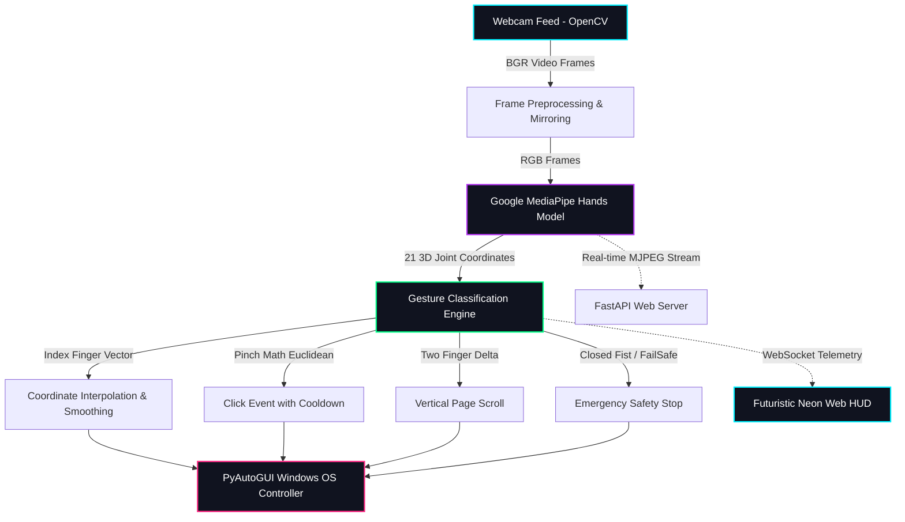

<div align="center">

# 🖐️ GestureOS
### *Control Your Computer With Your Hands*

<!-- Dynamic Typing SVG Animation -->
<a href="https://github.com/rakibul200514/GestureOS">
  
</a>

<p align="center">
  <b>A zero-hardware, AI-assisted computer vision application that transforms standard webcams into high-precision touchless mouse controllers.</b>
</p>

<!-- Dynamic Status Badges -->
<p align="center">
  
  
  
  
  
  
</p>

<p align="center">
  <a href="#-quick-demo">Quick Demo</a> •
  <a href="#-features">Features</a> •
  <a href="#-architecture">Architecture</a> •
  <a href="#-how-to-run">How To Run</a> •
  <a href="#-gesture-dictionary">Gestures</a> •
  <a href="#-viva-qa">Viva Q&A</a> •
  <a href="#-author">Author</a>
</p>

---

</div>

## 🌟 Highlights & Core Features

```
  ✨ 100% Zero External Hardware    👉 Uses standard laptop or USB webcam
  ⚡ Real-Time Hand Tracking        👉 Tracks 21 3D hand joints at 30-100+ FPS
  🎯 Exponential Smoothing Filter   👉 Eliminates hand tremors & jitter
  👌 Pinch-to-Click Detection       👉 Euclidean distance between Thumb & Index
  ✌️ Two-Finger Smooth Scrolling     👉 Natural page navigation across any app
  🛡️ Safe Mode by Default           👉 Explicit user toggle prevents accidental clicks
  🛑 Emergency Closed-Fist Stop     👉 Clench fist to immediately halt tracking
  🖥️ Dual Mode Execution           👉 Run as Native Windows App OR Cyberpunk Web HUD
```

---

## 🎮 Dual Run Modes (Windows 11 Ready)

GestureOS is engineered with **two distinct operating modes**:

| Mode | Launcher | Description |
| :--- | :--- | :--- |
| **1. Native Windows App (Recommended)** | `run_desktop_app.bat` | **No browser required!** Opens a high-tech floating HUD window and lets you control your entire Windows 11 PC (Chrome, VLC, YouTube, Desktop icons, File Explorer). |
| **2. Cyberpunk Web Dashboard** | `run_gestureos.bat` | Starts a **FastAPI backend** and opens an ultra-modern neon dashboard at `http://127.0.0.1:8000` with live HUD, telemetry, sensitivity sliders, and event logs. |

---

## 🖐️ Gesture Dictionary & Control Mapping

<div align="center">

| Gesture Icon | Gesture Name | Active Fingers | Triggered Desktop Action |
| :---: | :--- | :--- | :--- |
| ☝️ | **Pointer Mode** | Index UP, Others DOWN | **Moves Mouse Cursor** across entire monitor |
| 🤏 | **Pinch Click** | Thumb + Index Touch ($\text{dist} < 35\text{px}$) | **Left Mouse Click** (with 0.4s cooldown) |
| ✌️ | **Scroll Mode** | Index + Middle UP | **Vertical Scroll Up / Down** across all apps |
| ✋ | **Rest Mode** | Open Palm (All 5 Fingers UP) | **Pauses Tracking** (allows resting hand) |
| ✊ | **Emergency Lock** | Closed Fist (All Fingers DOWN) | **Instant Safety Stop** (disengages mouse) |

</div>

---

## 🏗️ System Architecture



---

## 📐 Mathematical Models

### 1. Euclidean Distance for Pinch Clicks:
$$\text{Distance} = \sqrt{(X_8 - X_4)^2 + (Y_8 - Y_4)^2}$$
*Where $(X_4, Y_4)$ is Thumb Tip and $(X_8, Y_8)$ is Index Tip.*

### 2. Active Tracking Zone Interpolation:
$$X_{\text{screen}} = \text{interp}\left(X_{\text{finger}}, [M, W - M], [0, \text{Screen}_W]\right)$$
$$Y_{\text{screen}} = \text{interp}\left(Y_{\text{finger}}, [M, H - M], [0, \text{Screen}_H]\right)$$
*Maps hand movements within comfortable camera boundary box $M$ to full monitor resolution.*

### 3. Exponential Moving Average (Jitter Reduction):
$$X_{\text{curr}} = X_{\text{prev}} + \frac{X_{\text{target}} - X_{\text{prev}}}{\alpha}$$
*Where $\alpha \ge 1$ is the smoothing coefficient (eliminates natural hand tremors).*

---

## ⚡ How To Run on Windows 11

### 1-Click Launchers (Easiest):
1. **For Native Desktop Control (No Browser):**
   - Double-click **`run_desktop_app.bat`**
   - Press **`s`** on your keyboard to enable mouse control!
2. **For Futuristic Web Dashboard:**
   - Double-click **`run_gestureos.bat`**
   - Opens automatically at `http://127.0.0.1:8000`

### Manual Run via Terminal:
```powershell
# 1. Clone repository
git clone https://github.com/rakibul200514/GestureOS.git
cd GestureOS

# 2. Run Native Desktop Controller
.\venv\Scripts\python.exe backend\desktop_app.py

# 3. Or Run Web Dashboard Server
.\venv\Scripts\python.exe backend\main.py
```

---

## 📂 Project Structure

```
GestureOS/
├── backend/
│   ├── desktop_app.py        # Native Windows 11 Desktop Controller (No Browser)
│   ├── hand_detector.py      # MediaPipe AI 21 Hand Landmarks Engine
│   ├── mouse_controller.py   # PyAutoGUI Safe Mouse & Smoothing Controller
│   ├── main.py               # FastAPI Server & MJPEG Stream Engine
│   ├── camera_test.py        # Camera & FPS Verification Tool
│   └── test_mouse_control.py # Desktop Control Integration Test
├── frontend/
│   ├── index.html            # Futuristic Neon Cyberpunk Dashboard
│   ├── style.css             # Glassmorphism & Cyberpunk Theme Styling
│   └── app.js                # Real-time WebSocket Telemetry & HUD Controls
├── tests/
│   └── test_units.py         # Unit Tests (100% Passed)
├── run_desktop_app.bat       # 1-Click Native Desktop Launcher
├── run_gestureos.bat         # 1-Click Web Dashboard Launcher
├── PROJECT_REPORT.md         # Full Academic BCA 3rd Sem Project Report
├── requirements.txt          # Python Dependencies
├── .gitignore                # Git Ignore Rules
└── README.md                 # Project Documentation
```

---

## 🎓 Q&A 

<details>
<summary><b>Click to expand Questions & Answers</b></summary>
<br>

**Q1: Why did we use MediaPipe instead of training a CNN from scratch?**  
> **Answer:** MediaPipe utilizes a lightweight two-stage pipeline (palm detector + landmark model) optimized with TFLite, running at 30+ FPS directly on standard CPUs without requiring GPU hardware.

**Q2: Why is BGR to RGB color conversion mandatory?**  
> **Answer:** OpenCV reads image frames in BGR format, while MediaPipe was trained on standard RGB color space. Passing BGR frames causes corrupted landmark predictions.

**Q3: How does the system prevent accidental multi-clicks?**  
> **Answer:** A software-level **Click Cooldown** mechanism ($0.4\text{s}$) prevents repetitive clicks within 400ms of an initial click event.

**Q4: How does video stream directly to the web browser?**  
> **Answer:** Through **MJPEG (Multipart JPEG) streaming** via FastAPI's `StreamingResponse` using MIME type `multipart/x-mixed-replace; boundary=frame`.

**Q5: What safety features are implemented?**  
> **Answer:** Safe Mode enabled by default, explicit keyboard toggle (`s`), closed-fist emergency stop, and PyAutoGUI corner failsafe.

</details>

---

## 👨‍💻 Author & Academic Details

- **Student Name:** Md Rakibul Islam
- **GitHub:** [@rakibul200514](https://github.com/rakibul200514)
- **Program:** Bachelor of Computer Applications (BCA) — 3rd Semester
- **Project Type:** Summer Project / Human-Computer Interaction (HCI)

---

<div align="center">
  <sub>Built with ❤️ using Python, OpenCV, and Google MediaPipe. If you found this project helpful, please give it a ⭐ on GitHub!</sub>
</div>
